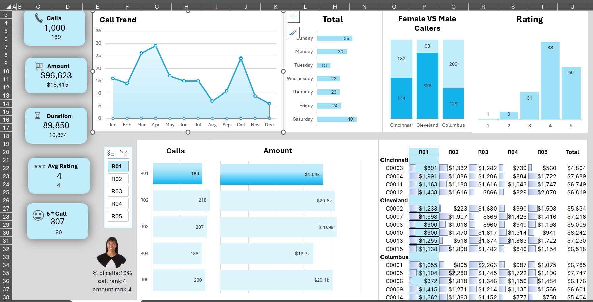

# 📊 Excel Call Center Dashboard

This repository contains an interactive Excel dashboard that visualizes **call center performance metrics** across multiple regions and customer segments.

## 🚀 Overview

The dashboard provides insights into:

- 📞 Total Calls
- 💰 Revenue Generated (Amount)
- ⏱️ Call Duration
- ⭐ Customer Ratings
- 👥 Gender Distribution
- 📍 Regional Performance (R01–R05)

## 📌 Key Features

- Dynamic filters for **regions**
- Trend analysis with **line charts**
- Bar charts comparing **gender, ratings, and call days**
- Individual performance breakdown by **customer ID** and **location**

## 📷 Dashboard Preview

## 🧩 Technologies Used

- Microsoft Excel (PivotTables, Slicers, Charts)
- Data visualization with condition 

📌 _Note: To interact with the dashboard, download the `dashboard.xlsx` file and open it in Excel Desktop with macros & slicers enabled.

